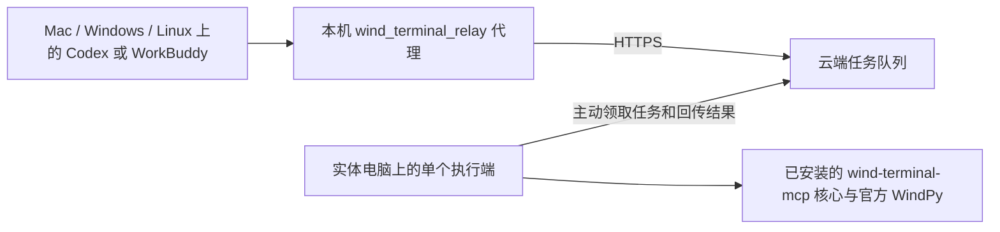

# Wind Terminal Relay

让各自电脑上的 Codex / WorkBuddy 通过 HTTPS 中继，向一台已能运行官方 WindPy 的实体电脑提交任务。客户端无需安装 Wind 金融终端，云服务器只维护队列和转发结果，真实 WindPy 始终在执行电脑上运行。

这是独立的中继项目。原本的 [wind-terminal-mcp](https://github.com/spikewzy/wind-terminal-mcp) 继续负责本机 WindPy 工具实现；本项目负责远程接入、排队、客户端权限和运维。两个项目分别发布，不把云端功能加入本地 MCP 的正式安装包。

| 部件 | 入口 | 安装位置 | 是否需要原 Wind 核心 / SDK |
| --- | --- | --- | --- |
| MCP 客户端代理 | `relay_client.py` | 每个人自己的电脑 | 不需要 |
| 网关与持久队列 | `relay_gateway.py` | 云服务器 | 不需要 |
| 执行端 | `relay_worker.py` | 已能运行 WindPy 的实体电脑 | 需要；由 `mcp_root` 指向现有核心 |

## 已部署旧网关：直接升级

下载发行页的 **wind-relay-gateway-upgrade-0.1.1.zip**，解压到新文件夹，双击 **Upgrade-Gateway.cmd**。它检查空闲队列、备份数据库、切换新版网关，核对按设备轮转和限流后恢复接单，并同时更新管理台及导出部署报告。保留原接入 JSON、Windows 任务凭据和取数端；失败回退不丢原任务。具体步骤见 [现有部署升级](gateway_update/README.md)。

## 云电脑统一管理台

已有网关可单独更新 [Wind 中继管理台](monitor/README.md)：监控运行状态、添加/撤销设备、下载接入文件、导出诊断包。下载 `wind-relay-console-0.2.1.zip`，在云电脑解压到新文件夹，双击 `Update.cmd`。复用现有 Python，仅更新管理台；本地 MCP、网关和信创执行端独立维护。旧后台未计量时仍显示未知，不推算官方额度。

## 并发处理

多人可以同时提交任务；网关排队，执行端每次只执行一个任务。真实 WindPy 调用继续使用原核心的原生锁和共享请求预算，不能靠增加执行端实例提高同一账号的吞吐量。

每个设备应有独立客户端凭据，例如 `alice-mac`、`alice-windows`、`bob-workbuddy`。这样可以单独撤销设备、隔离任务和回执，也能分设备记录调用。不要给所有人同一个 token。技术接入方式不会改变 Wind 账号本身的授权范围。

调度按客户端轮转，同一客户端内按提交顺序执行；正在运行的任务不会被强制抢占。可配置每客户端未完成任务上限、全局排队上限和提交频率限制，避免一台设备持续挤占队列。公平单位是设备凭据，不是自然人；一个人登记多台设备仍会占多个调度席位。

慢任务会先返回 `result_ready=false` 和 `job_id`，此时查询同一个任务编号，不能再次提交相同取数请求。已开始但结果不确定的任务暂停后续执行，保留原始标记，由管理员核查；系统不会自动重复取数。

## 调用量的口径

客户端通过 `relay_usage` 查看自己的聚合用量；管理员通过独立管理员权限查看全体与各客户端汇总。监控不向普通客户端开放别人的查询参数、原始值或回执。

默认查看滚动 7×24 小时：任务统计按入队时间分组，调用预留观测按执行时刻筛选；云端在任务结果回传后才看到观测事件。官方上限、剩余额度和恢复时间未知，程序不会按午夜或固定日期清零，也不会定时解除额度停机标记。

需要区分客户端提交任务、排队和执行次数、失败和等待时间、缓存命中、原生调用预留与估算数据单元。能力检查、回执读取和轮询属于中继通信，不能直接算成 Wind 数据调用。预留记录包括进入调用预算阶段的尝试，并非 SDK 实际执行成功次数；估算数据单元也不是 Wind 官方扣量。执行端共享的预算只统计本项目能够观察到的调用，不能替代 Wind 官方账户配额，也无法统计其他独立程序或终端操作。

使用不同客户端凭据隔离回执与缓存；相同查询在不同客户端首次执行时可能各消耗一次取数额度。本项目不会跨用户共享研究结果或回执来节省额度。

## 安装与来源

云电脑需要可视化状态页时，可单独添加 [云端监控器](monitor/README.md)：查看网关、取数电脑心跳、任务与设备状态，不提交 Wind 取数。兼容旧试验网关，无需为了安装监控器迁移正在运行的中继。

详见 [INSTALL.md](INSTALL.md)、[设计与计量口径](docs/DESIGN.md)、[设备管理及用量监控](docs/MONITORING.md)、[滚动额度规则](docs/QUOTA.md)和[从旧试验版本迁移](docs/MIGRATION.md)。推荐 Python 3.12，当前依赖锁要求 Python 3.11 或更新版本。客户端和网关可安装到完全独立目录；执行端复用原核心环境，但中继源码也可以放在独立目录中。

客户端提供原有 26 个工具，加 `relay_status`、`relay_usage`、`relay_job_status` 和 `relay_cancel_job`，合计 30 个工具。relay 本身版本为 0.1.0，支持的核心版本独立记录在工具契约中，不能用 relay 版本推断 Wind 核心版本。

本地直连 MCP 的配置名称为 `wind_terminal_api`；远程调用的配置名称为 `wind_terminal_relay`。它们可以同时存在，任务应明确指定入口。真实结果的数据来源仍为 `wind_terminal_api`，调用通道为中继；不能为了区分通道而改写原始上游 `source`。模拟结果标记为 `relay_mock`。

本包不包含 `server.py`、`wind_bridge/`、Wind SDK、账号凭据、运行数据库或旧部署验收报告。工具契约固定支持的核心版本和 `server.py` 哈希；升级原核心后必须同步核对契约，不能跳过不一致错误。

## 验证范围

0.1.0 在 Mac 上通过 109 项离线测试；包括模拟响应的外部核心兼容检查，没有发送真实 Wind 数据请求。完整口径见 [验收记录](docs/VERIFICATION.md)。该独立版本的发布不代表现有云端和信创执行电脑已升级。

此前试验已有 Mac 代理到 UOS 实体执行端的一次真实小样本查询、原始回执核对、双客户端权限隔离以及客户端重连取回结果的验证。独立目录的客户端无需核心代码即可完成 stdio 初始化和工具列表发现。

独立项目新增的跨平台 CI 是离线测试：不安装官方 Wind SDK，不实际登录 Wind，不连接生产网关。Windows 客户端实机接入、执行端故障恢复和多设备长时间运行需要分别验收；配置和模拟测试通过不等于这些部署环节已完成。

执行电脑关机、Wind 未登录或网关不可用时不能获取新 Wind 数据。已经回传的云端结果在保留期内仍可按原任务编号读取；实体电脑的回执按原核心方式保留。

